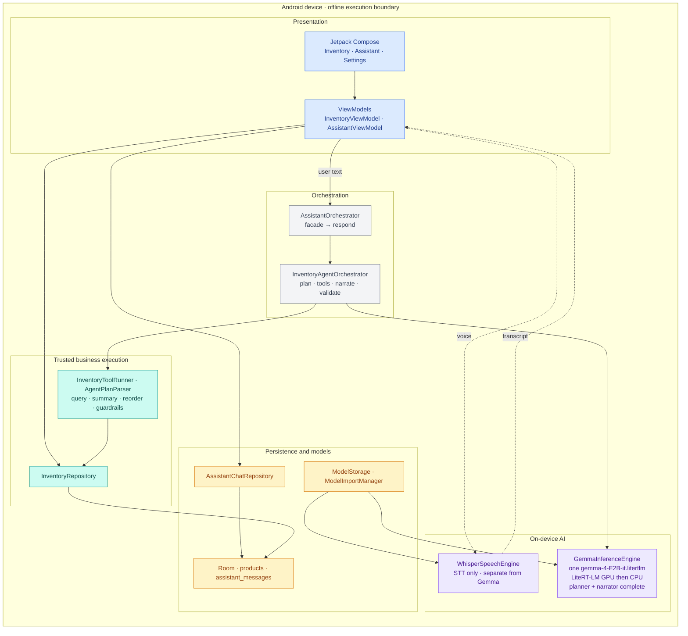
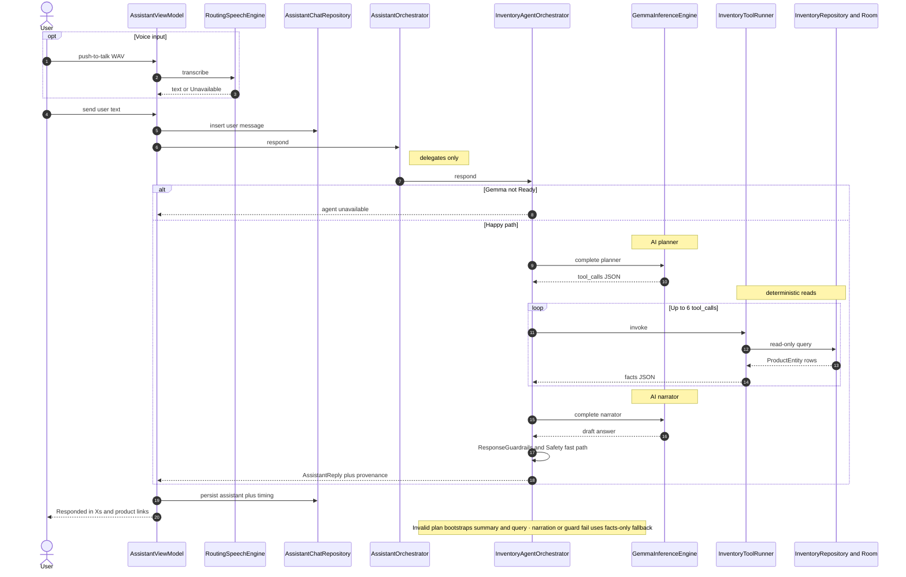

# StockPilot AI

Offline-first Android retail inventory with a conversational **on-device agent** (Gemma 4 E2B via LiteRT-LM, Whisper for voice). Read-only access to Room inventory; no cloud LLM; provenance on every assistant reply.

| | |
|---|---|
| **Application ID** | `com.stockpilot.ai` |
| **Stack** | Kotlin, Jetpack Compose (Material 3), Room, Navigation, DataStore, Hilt, coroutines, LiteRT-LM |

## Highlights (for reviewers)

- **~30s → ~10–12s** assistant latency on OnePlus 10 Pro (**GPU** first, CPU fallback); e.g. lookups ~**10s**, open-ended *“what’s the next best thing to do?”* ~**12s** (in-chat timer).
- **Plan → query → answer:** Gemma plans generic `tool_calls`; Kotlin runs Room tools; narrator uses **field glossary**—works for **lookups and arbitrary advisory questions** (no fixed intent menu).
- **Honest offline UX:** Model Manager, provenance labels, **“Responded in Xs”** on each assistant reply.

Full before/after write-up: **[IMPROVEMENTS.md](./IMPROVEMENTS.md)**

## Features

- Dashboard KPIs, search, stock filters, product editing (30-SKU seed catalog)
- **Inventory Assistant** — planner + read-only tools + narrator + guardrails; tappable product rows; persisted chat
- Voice: push-to-talk + Whisper when imported; TTS (default off)
- Model Manager: SAF import for Gemma + Whisper

## Architecture

On-device boundary: inventory UI, assistant chat, Gemma, Whisper, Room, and imported model files all run on the Android device.



**Orchestration:** `AssistantOrchestrator` is a thin façade; `InventoryAgentOrchestrator` owns planning, tool execution, narration, and validation.

**Cross-cutting (not separate pipeline stages):** Hilt DI, coroutines / `Flow`, and a mutex around Gemma inference lifecycle.

Editable source: [docs/architecture/system-architecture.mmd](./docs/architecture/system-architecture.mmd)

### AI request lifecycle

Example: *“Which products are out of stock, and what should I prioritize?”*



Editable source: [docs/architecture/ai-request-lifecycle.mmd](./docs/architecture/ai-request-lifecycle.mmd)

### Architectural decisions (concise)

| Topic | Rationale |
|-------|-----------|
| On-device inference | Privacy and offline retail use; trades cloud scale for local latency and RAM. |
| Gemma 4 E2B + LiteRT-LM | Mobile-sized instruction model with a single importable artifact and GPU/CPU backends. |
| Whisper separate from Gemma | STT and language reasoning differ in model lifecycle; typed chat works without voice models. |
| Planner vs narrator | Better tool selection and grounded answers; two `complete()` calls per turn (GPU mitigates latency). |
| Structured tools vs raw SQL | `InventoryToolRunner` exposes fixed read-only operations; filters live in Kotlin. |
| Deterministic reorder math | `ReorderCalculator` and repository code—not LLM arithmetic. |
| Response guardrails | Block mutation/SQL language in drafts; `AgentSafetyReview` fast path avoids a third Gemma call on success. |

## Performance optimization

Developer-measured on **OnePlus 10 Pro** (NE2211, Snapdragon 8 Gen 1), **GPU (Adreno)** path, same `gemma-4-E2B-it.litertlm`. Not independent benchmarks—see **[IMPROVEMENTS.md](./IMPROVEMENTS.md)**.

| Scenario | Wall time (approx.) | Notes |
|----------|---------------------|--------|
| CPU-only baseline (before GPU + agent tuning) | **~30s** | Single backend, heavier prompts |
| Focused inventory lookup | **~10s** | e.g. highest / zero on-hand |
| Open-ended advisory | **~12s** | e.g. prioritization across low/out stock |

| Improvement | Mechanism |
|-------------|-----------|
| **~60–67% lower latency** vs CPU baseline | GPU-first LiteRT-LM with CPU fallback |
| **~2.5–3× faster** (same device) | Combined with selective `query_products`, field glossary, no extra Gemma on safety success path |

Local chart source (not rendered on GitHub README): [docs/architecture/inference-performance.mmd](./docs/architecture/inference-performance.mmd)

## Build & run

From the repository root:

```bash
./gradlew assembleDebug
./gradlew testDebugUnitTest
```

Install: `app/build/outputs/apk/debug/app-debug.apk` or `./gradlew installDebug`

Open in Android Studio: sync Gradle, run on API 26+. Microphone permission from the Assistant screen when using voice.

## Models (not in git)

Import on device via **Settings → Model Manager**. See [GEMMA_MODEL_PREP.md](./GEMMA_MODEL_PREP.md) and [WHISPER_MODEL_PREP.md](./WHISPER_MODEL_PREP.md).

## Tests

| Suite | Examples |
|-------|----------|
| Unit | `InventoryProductQueryTest`, `AgentPlanParserTest`, `ChatResponseTimingTest`, `ReorderCalculatorTest` |
| Instrumented | `InventoryDaoInstrumentedTest` (device) |

## Docs index

| File | Purpose |
|------|---------|
| [IMPROVEMENTS.md](./IMPROVEMENTS.md) | Before/after, performance, agent design notes |
| [HANDOFF.md](./HANDOFF.md) | Operational handoff, import, limitations |
| [docs/architecture/](./docs/architecture/) | Mermaid diagram sources |
| [GEMMA_MODEL_PREP.md](./GEMMA_MODEL_PREP.md) | LiteRT artifact selection |
| [BUILD_PROGRESS.md](./BUILD_PROGRESS.md) | Milestone log |